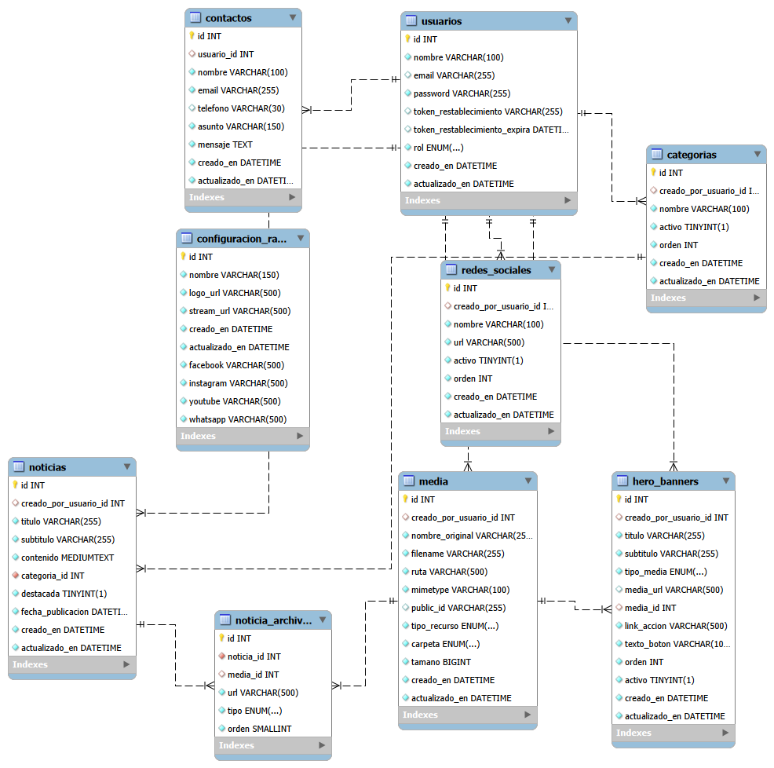

# Radio Burruyacu

Aplicación web full stack para la gestión y publicación de contenidos de Radio Burruyacu.

El proyecto está desarrollado con React, Node.js, Express, MySQL y Sequelize.

## Integrantes

Robledo Juan Gerardo

## Tecnologías

### Frontend

- React
- React Router DOM
- Zustand
- Tailwind CSS
- Vite
- PWA

### Backend

- Node.js
- Express
- Sequelize
- MySQL
- JWT
- bcrypt
- Multer

## Funcionalidades

- Sitio público con inicio, noticias, detalle de noticias, nosotros y contacto.
- Reproducción de radio en vivo.
- Formulario de contacto y pedidos de temas, disponible con sesión iniciada.
- Inicio de sesión con JWT.
- Registro público con rol `usuario` por defecto.
- Panel de administración protegido por rol.
- Gestión de noticias y categorías.
- Gestión de redes sociales.
- Gestión de banners e imágenes.
- Gestión de configuración y mensajes.
- Seguimiento de mensajes con estado pendiente o realizado.
- Subida de imágenes y videos.

## Roles

### Administrador

- Acceso completo al panel.
- Gestiona noticias.
- Gestiona categorías.
- Gestiona redes sociales.
- Consulta mensajes.
- Modifica la configuración de la radio.
- Gestiona usuarios.

### Usuario registrado

- Puede enviar consultas y pedidos de temas con su nombre y correo precargados.
- No tiene acceso al panel administrativo.

El registro está disponible desde la navegación del sitio. El backend asigna el rol `usuario`; el formulario no permite elegir ni elevar el rol.

## Requisitos previos

- Node.js 20.19 o superior, o 22.12 o superior (requisito de Vite 8).
- MySQL 8.
- npm.
- MySQL Workbench o una terminal compatible con MySQL.

## Instalación

### 1. Crear la base de datos

En MySQL Workbench, abrí y ejecutá `backend/db/radio.sql`. El script crea la base `radio`, las nueve tablas relacionadas y las categorías iniciales.

Para cargar cinco noticias informativas con sus imágenes locales, abrí y ejecutá `backend/db/datos_demo.sql` después de crear la base. Se puede ejecutar más de una vez sin duplicar esos registros.

## Usuarios de prueba

| Usuario | Contraseña | Rol |
|---|---|---|
| `admin_prueba` | `Admin123!` | Administrador |
| `usuario_prueba` | `Usuario123!` | Usuario |

Las contraseñas reales de producción no deben guardarse en el repositorio.

### 2. Configurar el backend

Ingresar a `backend`, copiar el archivo de ejemplo y completar los datos locales:

```powershell
cd backend
copy .env.example .env
npm install
```

Variables principales:

```env
PORT=5000
DB_HOST=localhost
DB_PORT=3306
DB_NAME=radio
DB_USER=root
DB_PASSWORD=tu_password
JWT_SECRETO=cambia-este-secreto
JWT_EXPIRACION=2h
```

Los usuarios también pueden crearse mediante el seeder:

```env
ADMIN_NOMBRE=admin_prueba
ADMIN_PASSWORD=Admin123!
USUARIO_NOMBRE=usuario_prueba
USUARIO_PASSWORD=Usuario123!
```

Ejecutar el seeder:

```powershell
npm run seed
```

Después de configurar el backend, los dos usuarios de prueba se crean con las variables `ADMIN_*` y `USUARIO_*` de `.env.example`. Las credenciales de la tabla anterior son solo para la demostración local; no las reutilices en producción.

Iniciar el backend:

```powershell
npm run dev
```

La API queda disponible, por defecto, en `http://localhost:5000`.

### 3. Configurar el frontend

Abrir otra terminal:

```powershell
cd frontend
copy .env.example .env
npm install
npm run dev
```

Ejemplo de `.env`:

```env
VITE_API=http://localhost:5000
```

El sitio queda disponible, por defecto, en `http://localhost:5173`.
El panel se encuentra en `http://localhost:5173/PanelAdmin`.

## Comandos disponibles

### Backend

```powershell
cd backend
npm run dev
npm run seed
npm start
```

### Frontend

```powershell
cd frontend
npm run dev
npm run build
npm run lint
npm run preview
```

## Base de datos

Tablas principales:

- `usuarios`
- `configuracion_radio`
- `redes_sociales`
- `media`
- `categorias`
- `noticias`
- `noticia_archivos`
- `hero_banners`
- `contactos`

Relaciones principales:

- Una categoría contiene muchas noticias.
- Una noticia contiene muchos registros de archivos.
- Un registro de media puede asociarse a archivos de noticias y banners.
- Un banner puede asociar opcionalmente un registro de media.

El script SQL principal se encuentra en [backend/db/radio.sql](backend/db/radio.sql).
Los datos iniciales de noticias e imágenes se encuentran en [backend/db/datos_demo.sql](backend/db/datos_demo.sql).

## Vistas CRUD de gestión

Cada una de las cinco entidades principales cuenta con una vista de listado, una vista de alta y una vista de edición:

| Entidad | Listado | Alta | Edición |
|---|---|---|---|
| Noticias | `/PanelAdmin/noticias` | `/PanelAdmin/noticias/nueva` | `/PanelAdmin/noticias/:id/editar` |
| Categorías | `/PanelAdmin/categorias` | `/PanelAdmin/categorias/nueva` | `/PanelAdmin/categorias/:id/editar` |
| Redes sociales | `/PanelAdmin/redes` | `/PanelAdmin/redes/nueva` | `/PanelAdmin/redes/:id/editar` |
| Usuarios | `/PanelAdmin/usuarios` | `/PanelAdmin/usuarios/nueva` | `/PanelAdmin/usuarios/:id/editar` |
| Banners | `/PanelAdmin/banners` | `/PanelAdmin/banners/nuevo` | `/PanelAdmin/banners/:id/editar` |

Las categorías se dan de baja lógicamente para conservar las noticias relacionadas; pueden reactivarse desde su listado.

### Diagrama entidad-relación

Captura del diagrama de tablas y relaciones de la base MySQL:



### Script de creación de la base de datos

Este es el contenido de `backend/db/radio.sql`. Crea la base `radio`, las nueve tablas, sus claves foráneas y las categorías iniciales:

```sql

CREATE DATABASE IF NOT EXISTS radio
  CHARACTER SET utf8mb4
  COLLATE utf8mb4_unicode_ci;

USE radio;

CREATE TABLE IF NOT EXISTS usuarios (
  id INT UNSIGNED NOT NULL AUTO_INCREMENT,
  nombre VARCHAR(100) NOT NULL,
  email VARCHAR(255) NULL,
  password VARCHAR(255) NOT NULL,
  token_restablecimiento VARCHAR(255) NULL,
  token_restablecimiento_expira DATETIME NULL,
  rol ENUM('admin','usuario') NOT NULL DEFAULT 'usuario',
  creado_en DATETIME NOT NULL DEFAULT CURRENT_TIMESTAMP,
  actualizado_en DATETIME NOT NULL DEFAULT CURRENT_TIMESTAMP
    ON UPDATE CURRENT_TIMESTAMP,
  PRIMARY KEY (id),
  UNIQUE KEY uq_usuarios_nombre (nombre),
  UNIQUE KEY uq_usuarios_email (email)
) ENGINE=InnoDB;

CREATE TABLE IF NOT EXISTS configuracion_radio (
  id INT UNSIGNED NOT NULL AUTO_INCREMENT,
  nombre VARCHAR(150) NOT NULL DEFAULT 'Radio Burruyacu',
  logo_url VARCHAR(500) NOT NULL DEFAULT '',
  stream_url VARCHAR(500) NOT NULL DEFAULT '',
  facebook VARCHAR(500) NOT NULL DEFAULT '',
  instagram VARCHAR(500) NOT NULL DEFAULT '',
  youtube VARCHAR(500) NOT NULL DEFAULT '',
  whatsapp VARCHAR(500) NOT NULL DEFAULT '',
  creado_en DATETIME NOT NULL DEFAULT CURRENT_TIMESTAMP,
  actualizado_en DATETIME NOT NULL DEFAULT CURRENT_TIMESTAMP
    ON UPDATE CURRENT_TIMESTAMP,
  PRIMARY KEY (id)
) ENGINE=InnoDB;

INSERT INTO configuracion_radio (nombre)
SELECT 'Radio Burruyacu'
WHERE NOT EXISTS (SELECT 1 FROM configuracion_radio);

CREATE TABLE IF NOT EXISTS redes_sociales (
  id INT UNSIGNED NOT NULL AUTO_INCREMENT,
  creado_por_usuario_id INT UNSIGNED NULL,
  nombre VARCHAR(100) NOT NULL,
  url VARCHAR(500) NOT NULL,
  activo TINYINT(1) NOT NULL DEFAULT 1,
  orden INT NOT NULL DEFAULT 0,
  creado_en DATETIME NOT NULL DEFAULT CURRENT_TIMESTAMP,
  actualizado_en DATETIME NOT NULL DEFAULT CURRENT_TIMESTAMP
    ON UPDATE CURRENT_TIMESTAMP,
  PRIMARY KEY (id),
  KEY idx_redes_activo_orden (activo, orden),
  KEY idx_redes_creador (creado_por_usuario_id),
  CONSTRAINT fk_redes_creador
    FOREIGN KEY (creado_por_usuario_id)
    REFERENCES usuarios (id)
    ON DELETE SET NULL
    ON UPDATE CASCADE
) ENGINE=InnoDB;

CREATE TABLE IF NOT EXISTS media (
  id INT UNSIGNED NOT NULL AUTO_INCREMENT,
  creado_por_usuario_id INT UNSIGNED NULL,
  nombre_original VARCHAR(255) NOT NULL,
  filename VARCHAR(255) NOT NULL,
  ruta VARCHAR(500) NOT NULL,
  mimetype VARCHAR(100) NOT NULL,
  public_id VARCHAR(255) NULL,
  tipo_recurso ENUM('image','video') NOT NULL DEFAULT 'image',
  carpeta ENUM('noticias','hero','radio') NOT NULL,
  tamano BIGINT UNSIGNED NOT NULL,
  creado_en DATETIME NOT NULL DEFAULT CURRENT_TIMESTAMP,
  actualizado_en DATETIME NOT NULL DEFAULT CURRENT_TIMESTAMP
    ON UPDATE CURRENT_TIMESTAMP,
  PRIMARY KEY (id),
  KEY idx_media_carpeta (carpeta, creado_en),
  KEY idx_media_creador (creado_por_usuario_id),
  CONSTRAINT fk_media_creador
    FOREIGN KEY (creado_por_usuario_id)
    REFERENCES usuarios (id)
    ON DELETE SET NULL
    ON UPDATE CASCADE
) ENGINE=InnoDB;

CREATE TABLE IF NOT EXISTS categorias (
  id INT UNSIGNED NOT NULL AUTO_INCREMENT,
  creado_por_usuario_id INT UNSIGNED NULL,
  nombre VARCHAR(100) NOT NULL,
  activo TINYINT(1) NOT NULL DEFAULT 1,
  orden INT NOT NULL DEFAULT 0,
  creado_en DATETIME NOT NULL DEFAULT CURRENT_TIMESTAMP,
  actualizado_en DATETIME NOT NULL DEFAULT CURRENT_TIMESTAMP
    ON UPDATE CURRENT_TIMESTAMP,
  PRIMARY KEY (id),
  UNIQUE KEY uq_categorias_nombre (nombre),
  KEY idx_categorias_activo_orden (activo, orden),
  KEY idx_categorias_creador (creado_por_usuario_id),
  CONSTRAINT fk_categorias_creador
    FOREIGN KEY (creado_por_usuario_id)
    REFERENCES usuarios (id)
    ON DELETE SET NULL
    ON UPDATE CASCADE
) ENGINE=InnoDB;

INSERT IGNORE INTO categorias (nombre, orden) VALUES
  ('Locales', 0),
  ('Policiales', 1),
  ('Salud', 2),
  ('Política', 3),
  ('Economía', 4),
  ('Eventos', 5),
  ('Deportes', 6);

CREATE TABLE IF NOT EXISTS noticias (
  id INT UNSIGNED NOT NULL AUTO_INCREMENT,
  creado_por_usuario_id INT UNSIGNED NULL,
  titulo VARCHAR(255) NOT NULL,
  subtitulo VARCHAR(255) NOT NULL DEFAULT '',
  contenido MEDIUMTEXT NOT NULL,
  categoria_id INT UNSIGNED NOT NULL,
  destacada TINYINT(1) NOT NULL DEFAULT 0,
  fecha_publicacion DATETIME NOT NULL DEFAULT CURRENT_TIMESTAMP,
  creado_en DATETIME NOT NULL DEFAULT CURRENT_TIMESTAMP,
  actualizado_en DATETIME NOT NULL DEFAULT CURRENT_TIMESTAMP
    ON UPDATE CURRENT_TIMESTAMP,
  PRIMARY KEY (id),
  KEY idx_noticias_fecha (fecha_publicacion DESC),
  KEY idx_noticias_categoria_id (categoria_id),
  KEY idx_noticias_destacada_fecha (destacada, fecha_publicacion DESC),
  KEY idx_noticias_creador (creado_por_usuario_id),
  CONSTRAINT fk_noticias_creador
    FOREIGN KEY (creado_por_usuario_id)
    REFERENCES usuarios (id)
    ON DELETE SET NULL
    ON UPDATE CASCADE,
  CONSTRAINT fk_noticias_categoria
    FOREIGN KEY (categoria_id)
    REFERENCES categorias (id)
    ON DELETE RESTRICT
    ON UPDATE CASCADE
) ENGINE=InnoDB;

CREATE TABLE IF NOT EXISTS noticia_archivos (
  id INT UNSIGNED NOT NULL AUTO_INCREMENT,
  noticia_id INT UNSIGNED NOT NULL,
  media_id INT UNSIGNED NULL,
  url VARCHAR(500) NOT NULL,
  tipo ENUM('imagen','video') NOT NULL,
  orden SMALLINT UNSIGNED NOT NULL DEFAULT 0,
  PRIMARY KEY (id),
  KEY idx_na_noticia (noticia_id, tipo, orden),
  CONSTRAINT fk_na_noticia
    FOREIGN KEY (noticia_id)
    REFERENCES noticias (id)
    ON DELETE CASCADE
    ON UPDATE CASCADE,
  CONSTRAINT fk_na_media
    FOREIGN KEY (media_id)
    REFERENCES media (id)
    ON DELETE SET NULL
    ON UPDATE CASCADE
) ENGINE=InnoDB;

CREATE TABLE IF NOT EXISTS hero_banners (
  id INT UNSIGNED NOT NULL AUTO_INCREMENT,
  creado_por_usuario_id INT UNSIGNED NULL,
  titulo VARCHAR(255) NOT NULL DEFAULT '',
  subtitulo VARCHAR(255) NOT NULL DEFAULT '',
  tipo_media ENUM('imagen','video') NOT NULL,
  media_url VARCHAR(500) NULL,
  media_id INT UNSIGNED NULL,
  link_accion VARCHAR(500) NOT NULL DEFAULT '',
  texto_boton VARCHAR(100) NOT NULL DEFAULT '',
  orden INT NOT NULL DEFAULT 0,
  activo TINYINT(1) NOT NULL DEFAULT 1,
  creado_en DATETIME NOT NULL DEFAULT CURRENT_TIMESTAMP,
  actualizado_en DATETIME NOT NULL DEFAULT CURRENT_TIMESTAMP
    ON UPDATE CURRENT_TIMESTAMP,
  PRIMARY KEY (id),
  KEY idx_hero_activo_orden (activo, orden),
  KEY idx_hero_creador (creado_por_usuario_id),
  CONSTRAINT fk_hero_creador
    FOREIGN KEY (creado_por_usuario_id)
    REFERENCES usuarios (id)
    ON DELETE SET NULL
    ON UPDATE CASCADE,
  CONSTRAINT fk_hero_media
    FOREIGN KEY (media_id)
    REFERENCES media (id)
    ON DELETE SET NULL
    ON UPDATE CASCADE
) ENGINE=InnoDB;

CREATE TABLE IF NOT EXISTS contactos (
  id INT UNSIGNED NOT NULL AUTO_INCREMENT,
  usuario_id INT UNSIGNED NULL,
  nombre VARCHAR(100) NOT NULL,
  email VARCHAR(255) NOT NULL,
  telefono VARCHAR(30) NULL,
  asunto VARCHAR(150) NOT NULL,
  mensaje TEXT NOT NULL,
  estado ENUM('pendiente','realizado') NOT NULL DEFAULT 'pendiente',
  creado_en DATETIME NOT NULL DEFAULT CURRENT_TIMESTAMP,
  actualizado_en DATETIME NOT NULL DEFAULT CURRENT_TIMESTAMP
    ON UPDATE CURRENT_TIMESTAMP,
  PRIMARY KEY (id),
  KEY idx_contactos_creado_en (creado_en),
  KEY idx_contactos_estado_creado (estado, creado_en),
  KEY idx_contactos_usuario (usuario_id),
  CONSTRAINT fk_contactos_usuario
    FOREIGN KEY (usuario_id)
    REFERENCES usuarios (id)
    ON DELETE SET NULL
    ON UPDATE CASCADE
) ENGINE=InnoDB;

SHOW TABLES;
```

## Pruebas SQL

Las consultas para insertar, consultar, actualizar y eliminar registros de todas las tablas se encuentran en:

- [backend/db/INSTRUCCIONES_PRUEBA_MYSQL.md](backend/db/INSTRUCCIONES_PRUEBA_MYSQL.md)

No es necesario ejecutar la aplicación para comprobar estas pruebas; pueden realizarse directamente en MySQL Workbench.

## Permisos del backend

Las rutas protegidas verifican el JWT y el rol del usuario.

| Rol | Operaciones permitidas |
|---|---|
| `admin` | Todas las operaciones del panel |
| `usuario` | Enviar consultas y pedidos de temas con sesión iniciada; leer contenido público |

Las rutas de administración requieren el rol `admin`. Las cuentas registradas desde el sitio reciben siempre `usuario`.

## Subida a GitHub

El proyecto está organizado para un único repositorio con `frontend/`, `backend/` y este `README.md` en la raíz. Inicializá Git desde esa carpeta. Los archivos `.env`, las dependencias y el build se excluyen con `.gitignore`; se incluyen las cinco ilustraciones SVG usadas por los datos iniciales. No publiques los archivos `.env` locales.


# RadioBurruyacu
